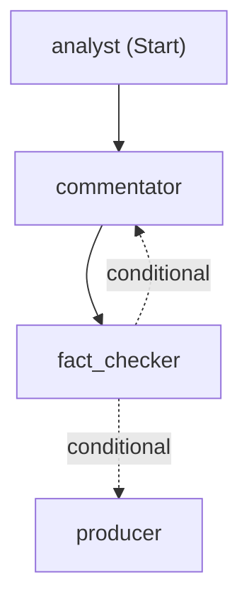

# The broadcast crew (AI agents)

Built with **Microsoft Agent Framework** on models deployed in **Microsoft Foundry**.
Every key moment the stats engine detects is handed to a crew of specialised agents,
the way a TV broadcast has an analyst, a commentator, a fact-checker and a producer.

*(Generated from the live workflow by `BroadcastCrew.diagram()`.)*

| Agent | Model | Job | Output |
|---|---|---|---|
| 🧠 **Analyst** | gpt-5-mini (reasoning, minimal effort) | The *why*: tactical cause or consequence, backed by numbers | `Insight`: headline, why it matters, supporting numbers, angle |
| 🎙 **Commentator** | gpt-4.1-mini | Broadcast words: a lower-third caption and an on-air line | `Commentary` |
| ✅ **Fact-checker** | *plain code* | Every number and player name must exist in the facts; no mixed alphabets | pass, or a list of problems sent back for a rewrite |
| 🎛 **Producer** | gpt-4.1-mini | One version per viewer: analyst or casual, favourite club and player, language | `PersonalizedLine`, fact-checked again |
| 📰 **Recap writer** | gpt-5-mini | Half-time and full-time story, with its own fact-check loop | `Recap` |

## Design principles

- **Numbers come from code, words come from AI.** Agents only receive a slice of the stats
  engine's state (`broadcast/context.py`) and may only use numbers from it.
- **Structured output everywhere.** Agents return validated JSON (Pydantic models), so each
  step can rely on exactly what the previous one produced.
- **Verification is code, not another model.** The fact-checker cannot hallucinate or be
  persuaded. Rejections go back to the writer with the exact problems (up to 2 rewrites).
- **The show goes on.** If the analyst is down, the commentator works from raw facts. If the
  commentary can't be verified, a safe line from the stats engine is shown. If personalisation
  fails, the verified neutral line is used. Every path is covered by tests (`tests/test_broadcast.py`).
- **Transparent.** Each result carries a trace (agent, time, fact-check notes), shown in the UI
  under "behind the scenes".
- **Keyless.** Foundry is called with Microsoft Entra ID (`az login` locally, managed identity
  in Azure). There are no API keys in code or config.
- **Cheap and fast.** One crew run is about 4–8 s and well under a cent. Results are cached per
  (match, moment, viewer profile), so identical viewers and replays cost nothing.

## Who gets commentary

`broadcast/relevance.py` (code, not AI): casual fans get the big moments; analysts also get
tactical ones (pressing spells, momentum swings, long possessions); anything involving your
club or player is included at a lower threshold. Substitutions never; half-time and full-time
get a recap instead.

## Languages

English, Spanish, French and Portuguese. All are Latin-script, so player names stay exactly as
written and the fact-checker can verify them. Adding one is a one-line change in `broadcast/models.py`.
